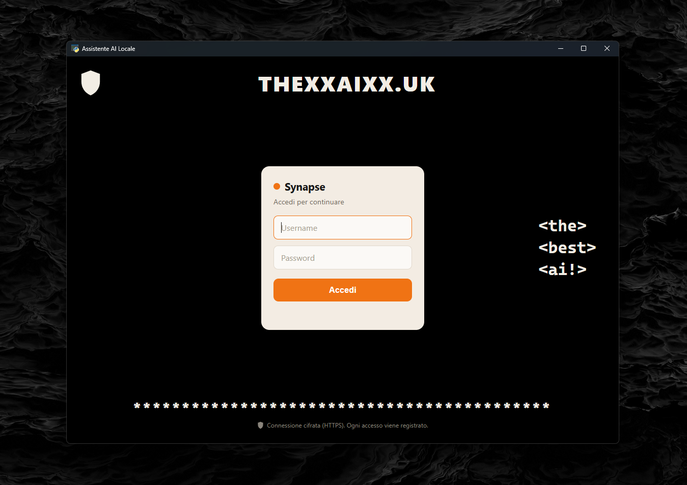
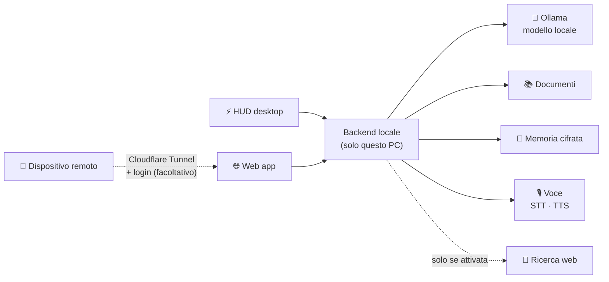

# 🧠 Synapse

### Il tuo assistente AI privato, che gira interamente sul tuo PC

*Offline per impostazione predefinita. I tuoi dati non lasciano mai il tuo computer.*

 

[English](README.md) · **Italiano**

---

<!-- Sostituisci con le tue immagini (cartella consigliata: docs/images/) -->

  

<i>Web app — schermata di accesso</i>

---

## ✨ Cos'è

**Synapse** è un assistente AI personale che fa girare un modello linguistico **in locale sul tuo PC**. Niente cloud, niente abbonamento, nessun dato inviato da nessuna parte: internet resta spento finché non lo accendi tu.

## 🎯 Perché Synapse

| | |
|---|---|
| 🔒 **Privato per progetto** | Il modello risponde sul tuo hardware. Internet è spento finché non lo attivi. |
| 💻 **Gira su hardware comune** | Costruito e testato su una sola RTX 3050 con 8 GB di VRAM. |
| 🪟 **Due interfacce, un solo assistente** | Un HUD minimale sul desktop per le domande veloci, una web app completa per il lavoro più lungo. |

## 🖥️ Interfacce

### ⚡ HUD desktop
Una barra minimale in stile Dynamic Island che non dà fastidio. Ha due dimensioni:

| Compatto | Espanso |
|:-:|:-:|
|  |  |
| Solo la barra degli strumenti | Barra con il campo di testo, pronta per una domanda |

| | |
|---|---|
| ⌨️ Scorciatoia globale | Si apre e si chiude con `Alt + Spazio` |
| 🫧 Design glassmorphism | Lascia passare i clic quando è inattivo |
| 🟢 Indicatore di stato | Pronto · sta generando · non disponibile |
| 💬 Memoria | Ricorda la conversazione, con la cronologia delle chat salvata |

### 🌐 Web app
Lo spazio di lavoro completo, come finestra del desktop o nel browser.

| | |
|---|---|
| 📁 Progetti | Cronologia delle conversazioni con ricerca |
| 🔐 Accesso remoto (facoltativo) | Accesso sicuro tramite Cloudflare Tunnel, con login |

## 🚀 Funzioni

| Funzione | Cosa fa |
|---|---|
| 📚 **Ricerca nei documenti locali** | Fai domande sui tuoi file PDF, Word, OpenDocument ed Excel; le risposte citano le fonti |
| 🧩 **Memoria a lungo termine** | Ricorda le informazioni utili tra una sessione e l'altra, cifrate sul tuo PC. Puoi rivederle o cancellarle quando vuoi |
| 🎙️ **Voce offline** | Riconoscimento vocale (faster-whisper) e sintesi vocale neurale (Piper), senza internet |
| 🧮 **Strumenti integrati** | Calcolatrice, conversione di unità, data e ora, promemoria |
| 🗺️ **Geografia italiana offline** | Oltre 63.000 località da GeoNames, con dettagli e distanze, tutto offline |
| 🔎 **Modalità mista** *(facoltativa)* | Ricerca web anonima, solo quando la attivi tu |

## 🏗️ Come sono collegati i pezzi

## 🛡️ Sicurezza e privacy

- ✅ **Offline per impostazione predefinita**: andare online è sempre una tua scelta
- ✅ **Backend solo in locale**: l'accesso remoto passa solo da un tunnel con autenticazione
- ✅ **Password salvate con hash e salt**, con cambio obbligatorio al primo accesso
- ✅ **Accesso basato sui ruoli**: le funzioni di amministrazione sono riservate agli admin
- ✅ **Dati locali cifrati** (Windows DPAPI)
- ✅ **Regola firewall facoltativa** per bloccare tutto il traffico in uscita
- ✅ **Protezione dalla prompt injection**: documenti e risultati web sono trattati come dati, mai come istruzioni

## ⚙️ Requisiti

| Requisito | Dettagli |
|---|---|
| 🪟 Sistema operativo | Windows 10 / 11 |
| 🎮 GPU | NVIDIA con almeno 8 GB di VRAM (testato su RTX 3050 8 GB) |
| 🦙 Runtime | [Ollama](https://ollama.com) con almeno un modello (predefinito: `qwen2.5:7b`) |

## 🆕 Novità — ottobre 2026

- 🎨 Nuovo HUD desktop minimale
- 🧹 **Modalità agente rimossa**: l'assistente non esegue più comandi e non modifica file, così ci sono meno punti d'attacco
- 🔐 Sicurezza rafforzata su autenticazione, controllo degli accessi ed esposizione in rete
- 💬 Memoria della conversazione e cronologia delle chat nell'HUD

## 🗺️ Roadmap

- [x] Modello locale con Ollama
- [x] Ricerca nei documenti locali con citazione delle fonti
- [x] Memoria a lungo termine cifrata
- [x] Voce offline (riconoscimento e sintesi vocale)
- [x] Strumenti integrati e geografia italiana offline
- [x] Ricerca web anonima facoltativa
- [x] Accesso remoto sicuro con Cloudflare Tunnel
- [x] Nuovo HUD desktop minimale
- [x] Sicurezza rafforzata e rimozione della modalità agente
- [ ] 🌟 Interfaccia web completamente ridisegnata
- [ ] 🌗 Tema chiaro e scuro
- [ ] 🖥️ Supporto multi-monitor e più impostazioni per l'HUD
- [ ] ⚡ Risposte più veloci

## 🕰️ Storia del progetto

- **Gennaio–aprile 2026, prima versione.** Non reggeva: le basi non erano abbastanza solide. Invece di metterci delle pezze, l'ho cancellata e sono ripartito da zero.
- **Giugno 2026, riscrittura completa.** È il Synapse attuale, sviluppato senza interruzioni da allora: oltre 150 ore finora, compreso un mese a tempo pieno a luglio.

## 👤 Autore

**Stefano**, maker di 17 anni dall'Italia.

- GitHub: *(questo profilo)*
- LinkedIn: *(in arrivo)*

## 📄 Licenza

© 2026 Stefano. **Tutti i diritti riservati.**

Synapse è software proprietario. Il codice sorgente non è pubblico. Nessuna parte di questa repository (testi, immagini, documentazione) può essere copiata, modificata, ridistribuita o usata a fini commerciali senza il permesso scritto dell'autore.

📩 Informazioni e collaborazioni: [licensing@thexxaixx.uk](mailto:licensing@thexxaixx.uk)
