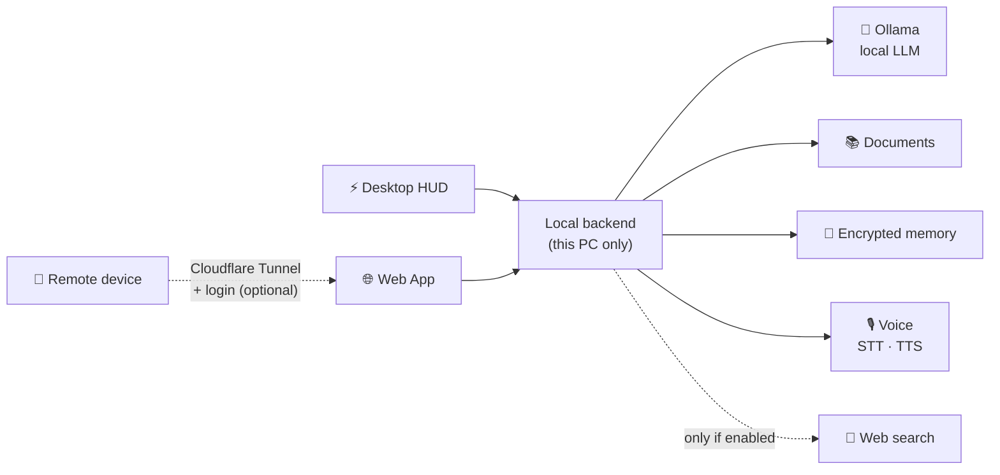

# 🧠 Synapse

### Your private AI assistant — running entirely on your own PC

*Offline by default. Your data never leaves your machine.*

 

**English** · [Italiano](README.it.md)

---

<!-- Replace with your own images (suggested folder: docs/images/) -->

  
  

<i>Desktop HUD · Web app</i>

---

## ✨ What it is

**Synapse** is a personal AI assistant that runs a large language model **locally on your PC**. No cloud, no subscription, no data sent anywhere: the internet stays off unless you explicitly turn it on.

## 🎯 Why Synapse

| | |
|---|---|
| 🔒 **Private by design** | A local LLM answers on your own hardware. Internet is off unless you enable it. |
| 💻 **Runs on consumer hardware** | Built and tested on a single RTX 3050 with 8 GB of VRAM. |
| 🪟 **Two interfaces, one assistant** | A minimal desktop HUD for quick questions, a full web app for longer work. |

## 🖥️ Interfaces

### ⚡ Desktop HUD
A minimal, Dynamic Island–style bar that stays out of your way.

| | |
|---|---|
| ⌨️ Global shortcut | Opens and closes with `Alt + Space` |
| 🫧 Glassmorphism design | Click-through when idle |
| 🟢 Live status dot | Ready · generating · unavailable |
| 💬 Memory | Remembers the conversation, with saved chat history |

### 🌐 Web App
The full workspace, as a desktop window or in the browser.

| | |
|---|---|
| 📁 Projects | Conversation history with search |
| 🔐 Remote access (optional) | Secure access via Cloudflare Tunnel, behind login |

## 🚀 Features

| Feature | What it does |
|---|---|
| 📚 **Local document search** | Ask questions about your PDF, Word, OpenDocument and Excel files; answers cite their sources |
| 🧩 **Long-term memory** | Remembers useful facts across sessions, encrypted on your PC. Review or delete anytime |
| 🎙️ **Offline voice** | Speech-to-text (faster-whisper) and neural text-to-speech (Piper), no internet needed |
| 🧮 **Built-in utilities** | Calculator, unit conversion, date and time, reminders |
| 🗺️ **Offline Italian geography** | 63,000+ places from GeoNames, with details and distances, fully offline |
| 🔎 **Mixed mode** *(optional)* | Anonymous web search, only when you explicitly enable it |

## 🏗️ How it fits together

## 🛡️ Security & privacy

- ✅ **Offline by default**: going online is always your choice
- ✅ **Local-only backend**: remote access only through an authenticated tunnel
- ✅ **Salted password hashing**, with a mandatory password change on first login
- ✅ **Role-based access**: admin functions restricted to admins
- ✅ **Encryption at rest** for local data (Windows DPAPI)
- ✅ **Optional firewall rule** to block all outbound traffic
- ✅ **Prompt-injection aware**: documents and web results are treated as data, never as instructions

## ⚙️ Requirements

| Requirement | Details |
|---|---|
| 🪟 OS | Windows 10 / 11 |
| 🎮 GPU | NVIDIA with 8 GB+ VRAM (tested on RTX 3050 8 GB) |
| 🦙 Runtime | [Ollama](https://ollama.com) with at least one model (default: `qwen2.5:7b`) |

## 🆕 What's new — October 2026

- 🎨 Brand-new minimal desktop HUD
- 🧹 **Agent mode removed**: the assistant no longer runs commands or edits files, which shrinks the attack surface
- 🔐 Security hardening across authentication, access control and network exposure
- 💬 Conversation memory and chat history in the HUD

## 🗺️ Roadmap

- [x] Local LLM via Ollama
- [x] Local document search with source citations
- [x] Encrypted long-term memory
- [x] Offline voice (speech-to-text and text-to-speech)
- [x] Built-in utilities and offline Italian geography
- [x] Optional anonymous web search
- [x] Secure remote access via Cloudflare Tunnel
- [x] New minimal desktop HUD
- [x] Security hardening and removal of agent mode
- [ ] 🌟 Completely redesigned web interface
- [ ] 🌗 Light and dark themes
- [ ] 🖥️ Multi-monitor support and more HUD settings
- [ ] ⚡ Faster responses

## 🕰️ Project history

- **January–April 2026 — first version.** It didn't hold up: the foundations weren't good enough. Instead of patching it, I deleted it and started over.
- **June 2026 — complete rewrite.** The current Synapse, developed continuously since then: 150+ hours so far, including a full-time month in July.

## 👤 Author

**Stefano**, 17-year-old maker from Italy.

- GitHub: *(this profile)*
- LinkedIn: *(coming soon)*

## 📄 License

© 2026 Stefano. **All rights reserved.**

Synapse is proprietary software. The source code is not public. No part of this repository (text, images, documentation) may be copied, modified, redistributed or used commercially without written permission from the author.

📩 Information and collaborations: [licensing@thexxaixx.uk](mailto:licensing@thexxaixx.uk)
